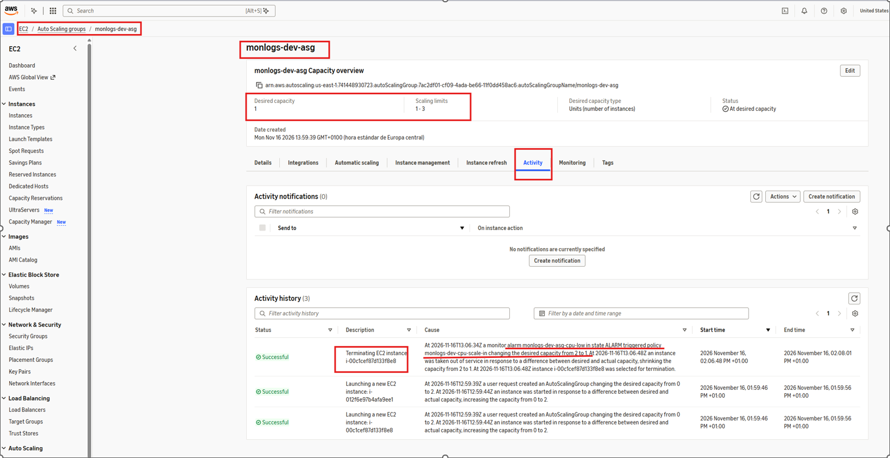
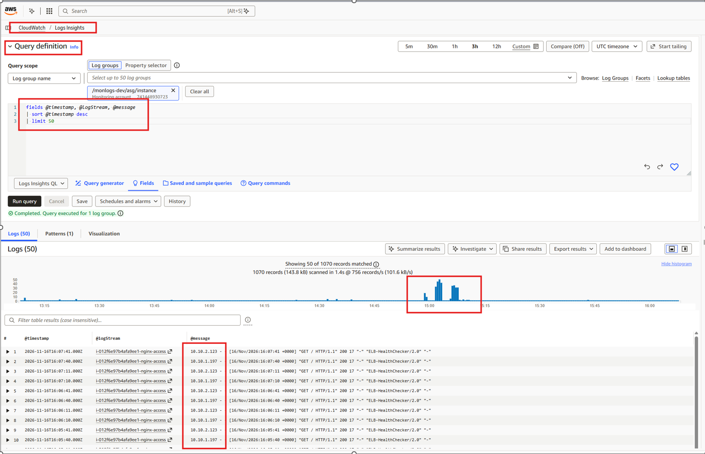
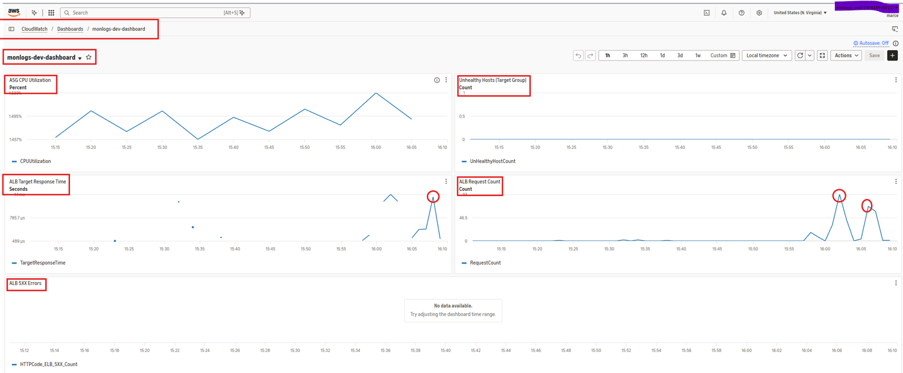
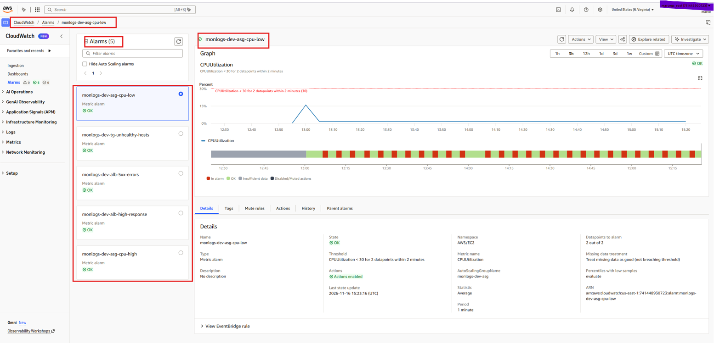

# MONITORIZACION_LOGS_ASG_ALB

[](https://github.com/marcegc84-bot/MONITORIZACION_LOGS_ASG_ALB/actions/workflows/terraform-ci.yml)

Laboratorio personal de infraestructura en AWS con Terraform, construido siguiendo prácticas de producción: **ALB + Auto Scaling Group (nginx) + CloudWatch** (logs, alarmas, dashboard y alertas por email) y un **clúster EKS** que convive con ellos. Está organizado en módulos reutilizables, entornos separados (`dev` y `prod`) y stacks por capas con estado remoto en S3.

> **Es un laboratorio, no un sistema en producción.** Está pensado para practicar y demostrar cómo se estructura y opera una plataforma en AWS. La sección [Estado de verificación](#estado-de-verificación) detalla qué se ha probado de verdad y qué no.

## Arquitectura

```
                          Internet
                             │ 80 (443 con certificado)
                  ┌──────────▼──────────┐
   subnets        │   ALB (SG propio)   │──► access logs ► S3 (cifrado, con expiración)
   públicas       └──────────┬──────────┘
                             │ solo desde el SG del ALB
                  ┌──────────▼──────────┐
   subnets        │  ASG · nginx        │──► CloudWatch Agent ► CloudWatch Logs
   privadas       │  IMDSv2 · EBS cifr. │──► acceso por SSM Session Manager (sin SSH)
                  └──────────┬──────────┘
                             │ salida por NAT Gateway
                  CloudWatch: alarmas ► SNS ► email · alarmas CPU ► políticas de escalado · dashboard

   subnets        ┌─────────────────────────────────────────────┐
   privadas       │ EKS: control plane + node groups            │◄── el ALB también puede enviar
   (mismas)       │  general · monitoring (con taint)           │    tráfico a los pods (canary)
                  │ OIDC/IRSA · add-ons · access entries        │
                  └─────────────────────────────────────────────┘
```

## Estado de verificación

| Componente | Estado |
|---|---|
| `terraform fmt` y `terraform validate` en los 7 stacks | Comprobado, también en CI |
| `bootstrap` (bucket de estado) | Desplegado en AWS |
| `dev/00-network` (19 recursos) | Desplegado y destruido |
| `dev/10-asg-alb` (28 recursos) | Desplegado, probado y destruido |
| `dev/20-eks` | Validado con `terraform validate`; **no desplegado todavía** |
| `prod/*` | Validado con `terraform validate`; **no desplegado** |

Lo observado en el despliegue de `dev`: instancias `InService` y `Healthy` en subnets privadas sin IP pública, health checks del ALB llegando a nginx con código 200 desde las subnets públicas, logs de nginx (`access` y `error`) en CloudWatch Logs, y el ASG reduciendo su capacidad por la alarma de CPU baja.

## Capturas

| | |
|---|---|
|  |  |
| Instancias del ASG, sanas y sin IP pública | Logs de nginx con los health checks del ALB |
|  |  |
| Dashboard de CloudWatch | Alarmas y política de escalado |

## Decisiones de diseño

| Decisión | Motivo |
|---|---|
| Instancias en subnets privadas con salida por NAT | No exponer las instancias directamente a Internet; solo el ALB es público |
| Acceso por SSM Session Manager, sin SSH | Sin puerto 22 abierto ni gestión de claves |
| IMDSv2 obligatorio y EBS cifrado | Reducir el riesgo de robo de credenciales vía SSRF y proteger los datos en reposo |
| SG de las instancias: entrada solo desde el SG del ALB | Principio de mínimo privilegio entre capas |
| Estado remoto en S3 con `use_lockfile` | Sin DynamoDB: bloqueo nativo desde Terraform 1.10 |
| Un stack por capa (red, aplicación, EKS), cada uno con su estado | Menor radio de impacto en un `apply`; la red vive más que la aplicación |
| Una NAT en dev, una por zona en prod | Equilibrio coste/disponibilidad: en dev, si cae la zona de la NAT, las instancias de la otra pierden salida |
| `versions.tf` único en `config/` con comprobación en CI | Terraform solo admite un `required_providers` por stack y obliga a copiarlo; el CI evita que las copias se desvíen |
| EKS con access entries y OIDC/IRSA | Sin `aws-auth` y con roles de IAM por pod en lugar de credenciales de nodo |

## Coste aproximado (dev, us-east-1)

Aproximado y orientativo; comprueba los precios actuales en la web de AWS.

| Stack | Por hora, aprox. |
|---|---|
| `00-network` + `10-asg-alb` (NAT, ALB, 2 × t2.micro) | 0,12 $ |
| `20-eks` (control plane + 3 nodos) | +0,27 $ |
| Todo junto | 0,40 $ |

EKS cobra 0,10 $/h solo por existir el clúster. Para evitar sustos: configura un AWS Budget con alerta antes de desplegar, destruye en el mismo día y no dejes nada encendido.

## Estructura

```
.
├── config/
│   └── versions.tf             # ÚNICO origen de versiones de Terraform y providers
├── bootstrap/                  # Bucket S3 del estado remoto (se aplica una sola vez)
├── modules/                    # Código reutilizable, sin valores concretos
│   ├── network/                # VPC, subnets públicas/privadas, IGW, NAT, rutas, flow logs
│   ├── alb/                    # ALB, target group, listeners, SG y bucket de access logs
│   ├── asg/                    # Launch template, ASG, SG de instancias, IAM, userdata
│   ├── eks/                    # Clúster EKS, node groups, OIDC/IRSA, add-ons, access entries
│   ├── cw_logs/                # Log group de CloudWatch
│   └── monitoring/             # SNS, alarmas, políticas de escalado y dashboard
├── environments/
│   ├── dev/
│   │   ├── 00-network/         # Stack 1: red
│   │   ├── 10-asg-alb/         # Stack 2: aplicación (lee la red por remote state)
│   │   └── 20-eks/             # Stack 3: Kubernetes (lee la red y el ALB por remote state)
│   └── prod/                   # Mismo código que dev, con valores de producción
│       ├── 00-network/
│       ├── 10-asg-alb/
│       └── 20-eks/
├── docs/                       # Capturas (images/) y notas de migración
├── Makefile
└── .github/workflows/          # CI: versiones sincronizadas, terraform fmt y validate
```

Los módulos **no** llevan `versions.tf`: heredan las versiones del stack que los llama.

Cada carpeta de `environments/<env>/<stack>` es un **stack con su propio estado** en S3 y solo contiene la llamada a los módulos más sus valores (`terraform.tfvars`, `backend.hcl`). Separar red y aplicación reduce el radio de impacto de un `apply` y permite que la red viva más tiempo que la aplicación.

| Estado en S3 | Stack |
|---|---|
| `dev/network/terraform.tfstate` | `environments/dev/00-network` |
| `dev/asg-alb/terraform.tfstate` | `environments/dev/10-asg-alb` |
| `prod/network/terraform.tfstate` | `environments/prod/00-network` |
| `prod/asg-alb/terraform.tfstate` | `environments/prod/10-asg-alb` |
| `dev/eks/terraform.tfstate` | `environments/dev/20-eks` |
| `prod/eks/terraform.tfstate` | `environments/prod/20-eks` |

## Diferencias entre dev y prod

| | dev | prod |
|---|---|---|
| AZ | 2 | 3 |
| NAT Gateway | 1 (compartido) | 1 por AZ |
| VPC Flow Logs | no | sí |
| Instancias | `t2.micro`, 1–3 (deseadas 2) | `t3.small`, 2–6 (deseadas 3) |
| Protección contra borrado del ALB | no | sí |
| Bucket de access logs | se puede destruir | protegido |
| Retención de logs | 14 días | 90 días |
| EKS: versión de Kubernetes | 1.36 | 1.36 |
| EKS: nodos | `general` 2 × t3.medium + `monitoring` 1 × t3.large | `general` 3 × t3.large + `monitoring` 2 × t3.large |
| EKS: API server | público, solo desde tu IP | privado (VPN, bastion o SSM) |
| EKS: cifrado de Secrets con KMS | no | sí |

## Requisitos

- Terraform **>= 1.10** (el bloqueo de estado nativo de S3 con `use_lockfile` lo requiere)
- AWS CLI con credenciales configuradas
- `make` y `kubectl`
- En Windows, usa **Git Bash** (o WSL): las recetas del `Makefile` usan sintaxis de bash. Si no puedes instalar `make`, cada objetivo equivale a un comando `terraform -chdir=...` (mira el `Makefile`).
- Usa un usuario o rol de IAM con permisos suficientes; evita trabajar con el usuario root de la cuenta.

## Despliegue

### 1. Bucket de estado (una vez)

```bash
cd bootstrap
terraform init
terraform apply -var="bucket_name=monlogs-tfstate-<id-de-tu-cuenta>"
cd ..
export STATE_BUCKET=monlogs-tfstate-<id-de-tu-cuenta>
```

### 2. Red

```bash
make init  ENV=dev STACK=00-network STATE_BUCKET=$STATE_BUCKET
make plan  ENV=dev STACK=00-network STATE_BUCKET=$STATE_BUCKET
make apply ENV=dev STACK=00-network STATE_BUCKET=$STATE_BUCKET
```

### 3. Aplicación

El email de alertas no se guarda en el repositorio:

```bash
export TF_VAR_alert_email="tu@correo"
make init  ENV=dev STACK=10-asg-alb STATE_BUCKET=$STATE_BUCKET
make apply ENV=dev STACK=10-asg-alb STATE_BUCKET=$STATE_BUCKET
make output ENV=dev STACK=10-asg-alb STATE_BUCKET=$STATE_BUCKET   # alb_dns_name
```

Abre `http://<alb_dns_name>` (las instancias tardan unos minutos en pasar el health check) y confirma la suscripción SNS que llega al correo.

### 4. Kubernetes (EKS)

`00-network` define en `eks_cluster_name` el nombre del clúster (`monlogs-dev-eks`). Lo exporta como output y `20-eks` lo lee, de modo que las etiquetas de las subnets y el clúster no pueden divergir. Si has aplicado la red antes de añadir EKS, vuelve a aplicarla: solo añade etiquetas a las subnets y ese output.

```bash
make apply ENV=dev STACK=00-network STATE_BUCKET=$STATE_BUCKET        # solo si la red ya estaba creada

# Acceso al API solo desde tu IP
export TF_VAR_api_allowed_cidrs="[\"$(curl -s https://checkip.amazonaws.com)/32\"]"

make init  ENV=dev STACK=20-eks STATE_BUCKET=$STATE_BUCKET
make plan  ENV=dev STACK=20-eks STATE_BUCKET=$STATE_BUCKET
make apply ENV=dev STACK=20-eks STATE_BUCKET=$STATE_BUCKET             # ~15 min
make kubeconfig ENV=dev STATE_BUCKET=$STATE_BUCKET

kubectl get nodes
kubectl get pods -A
```

Qué crea `20-eks`:

- Clúster con **access entries** (sin `aws-auth`): quien lo crea es administrador, y puedes añadir más con `cluster_admin_arns`.
- Dos node groups gestionados: `general` y `monitoring`, este último con el taint `dedicated=monitoring:NoSchedule` y la etiqueta `role=monitoring`. Al instalar Prometheus y Grafana añade `tolerations` y `nodeSelector` en los values de Helm.
- OIDC provider para **IRSA** y el rol del driver EBS CSI.
- Add-ons: `vpc-cni`, `kube-proxy`, `coredns` y `aws-ebs-csi-driver`.
- Log group del control plane con retención definida.
- Una regla en el SG del clúster que permite al **ALB de `10-asg-alb`** llegar a los pods (`enable_alb_integration`). Es la base para la migración gradual ASG → EKS con pesos en el listener.

El ALB envía tráfico a los pods por el puerto `app_port` (80 por defecto), el mismo que usa para las instancias del ASG. Si tus pods escuchan en otro puerto, cambia `app_port` en ambos stacks.

### 5. Destruir (orden inverso)

Antes de destruir EKS, borra de Kubernetes todo lo que haya creado balanceadores o volúmenes (`Service` de tipo `LoadBalancer`, `Ingress`, `PVC`). Si no, quedan recursos de AWS huérfanos que impiden borrar la VPC.

```bash
make destroy ENV=dev STACK=20-eks     STATE_BUCKET=$STATE_BUCKET
make destroy ENV=dev STACK=10-asg-alb STATE_BUCKET=$STATE_BUCKET
make destroy ENV=dev STACK=00-network STATE_BUCKET=$STATE_BUCKET
```

### Versionar los lock files

Tras el primer `init` de cada stack aparece un `.terraform.lock.hcl`. **Haz commit de ellos**: fijan las versiones exactas de los providers.

## Versiones de Terraform y providers

Se definen **una sola vez**, en `config/versions.tf`. Terraform no permite importar un fichero de otra carpeta, así que cada stack necesita una copia física; `make sync-versions` la genera idéntica en `bootstrap/` y en los seis stacks de `environments/`, y el CI (`make check-versions`) falla si alguna copia se desvía.

Para subir una versión:

```bash
# 1. Edita config/versions.tf
make sync-versions
make validate-all
# 2. En cada stack: terraform init -upgrade y haz commit de los .terraform.lock.hcl
```

Terraform solo admite un bloque `required_providers` por stack, por eso `tls` está en el mismo fichero aunque solo lo use `20-eks`.

## Ahorrar coste en el laboratorio

Se cobran por hora, aunque no tengan tráfico: el **control plane de EKS**, los **nodos**, el **NAT Gateway** y los balanceadores. Comprueba los precios actuales en la web de AWS y haz `destroy` al terminar cada sesión.

- EKS necesita salida a internet desde las subnets privadas, así que mantén el NAT mientras el clúster exista.
- Si solo trabajas con la parte ASG/ALB: `enable_nat_gateway = false` en `00-network` y `app_in_private_subnets = false` en `10-asg-alb` (las instancias van a subnets públicas con IP pública).
- Pon `desired_size = 0` en el node group `monitoring` hasta que instales Prometheus.

## Origen del proyecto

Nació de un curso práctico de Terraform como un único directorio con estado local. Qué se ha cambiado al llevarlo a una estructura modular y qué problemas tenía el original está en [`docs/MIGRACION.md`](docs/MIGRACION.md).

## Siguiente paso: capa `30-addons`

`20-eks` exporta `oidc_provider_arn`, `oidc_provider_host`, `cluster_endpoint` y `cluster_certificate_authority_data`, y `10-asg-alb` exporta `listener_arn` y `legacy_tg_arn`. Con eso, un stack `environments/dev/30-addons` con el provider de Helm puede instalar:

1. **AWS Load Balancer Controller** (rol IRSA propio) y un `TargetGroupBinding` hacia el listener del ALB existente, para el canary con pesos entre el target group del ASG y el de los pods.
2. **kube-prometheus-stack** en los nodos `monitoring` (tolerations y nodeSelector), con almacenamiento en EBS.
3. **Argo CD** para GitOps.

## Mejoras habituales que quedan fuera

- HTTPS con un certificado de ACM (`certificate_arn`) y un dominio en Route 53.
- AWS WAF delante del ALB.
- Sustituir las políticas de escalado simple por *target tracking*.
- Análisis de seguridad en CI (`tflint`, `trivy config` o `checkov`).
- CI con `terraform plan` en cada pull request, autenticando GitHub Actions contra AWS mediante OIDC (sin claves de acceso guardadas).
- Registrar la IP real del cliente en los logs de nginx (`X-Forwarded-For`).
